## About

Hi, I'm Atharv. I'm a first-year Software Engineering student at the University of Waterloo.

I like building things I can measure and explain: a pipeline whose numbers I can reproduce, a test that catches my own mistake, a design decision I can defend in a sentence. I also read a lot, which is how my current project started.

## Currently building

**[Bifrost](https://github.com/atharv-pandey-08/bifrost)** is a fiction recommender that measures when book text beats reader behaviour. It compares five models on a time-ordered split of Goodreads data and reports results with confidence intervals.

- **Where it stands:** the data ingest is done and tested. It loads 34.9M reader interactions across 93k books in about 16 seconds. The models and evaluation are next, so there are no results yet.
- **Why it's interesting:** I found that 29% of readers in my development set added their last two books on the same day, which makes "last book" a shaky test. I kept the split and report every result two ways. The reasoning is logged in the repo.

## Experience

**University of Waterloo**, Bachelor of Software Engineering (Honours, Co-op), Sept 2026 to present.

**ML + Front-End Infra Developer, [WAT.ai](https://watai.ca)** (Sept 2026 to May 2027). Waterloo
- Contributing to a team research project on adaptive-compute inference for a flow-matching text-to-speech model. I ran speaker-similarity sweeps and wrote the analysis, plots and results write-up.
- Built a per-run evaluation module that scores speaker similarity, word error rate and runtime for each generated clip, flags invalid audio without crashing, and writes one JSON record per run. It's covered by 10 unit tests.
- Diagnosed a dependency bug that made every transcription fail and proposed the version pin. I checked it by rescoring 968 saved transcripts, and all of them matched.

**SAP Technical Intern, Forestallers** (May to Aug 2025). Vancouver
- Developed and debugged SAP ABAP components for a test-data provisioning and masking product.
- Led requirements meetings with an enterprise client and worked with the CEO to build client-facing presentations.

**Team Leader, UBC Physics Olympics** (Jan to Mar 2025).
- Led a team across electrical, mechanical and coding sub-teams to build a solar-powered boat. We placed 5th of 81 teams, and iterative testing raised the boat's speed by 27%.

## Toolkit

## Side quests

When I'm not coding I'm usually in a story: **God of War**, **Uncharted**, **Batman** and **Marvel**. On the shelf, I'd hand these to anyone: *Sword of Kaigen*, *The Goldfinch* and *Norwegian Wood*.

*God of War and Uncharted belong to Sony Interactive Entertainment, Batman to DC, and Marvel to Marvel Entertainment. This page is a fan's homage and isn't affiliated with or endorsed by any of them. The artwork here is original and uses none of their characters, logos or art.*

## Find me

